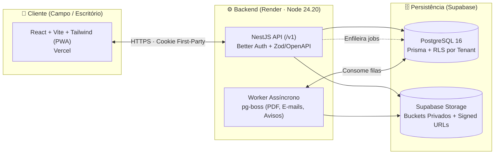

<div align="center">


<p>
  <strong>Gestão operacional para prestadores de serviço técnico em campo</strong><br />
  Agenda, clientes, histórico completo, orçamentos em PDF e avisos de manutenção recorrente em um só lugar.
</p>

<!-- TODO: adicionar screenshots/GIF e link da demo quando disponível -->

<p>
  
  <a href="docs/adr/0001-licenca-e-modelo-de-negocio.md"></a>
  <a href="docs/adr/0002-runtime-node-vs-bun.md"></a>
  
</p>

<p>
  
</p>

<h4>
  <a href="docs/01-visao-e-escopo.md">Visão e Escopo</a> ·
  <a href="docs/02-requisitos.md">Requisitos</a> ·
  <a href="docs/03-arquitetura.md">Arquitetura (C4)</a> ·
  <a href="docs/roadmap.md">Roadmap</a> ·
  <a href="docs/adr/README.md">ADRs</a> ·
  <a href="docs/README.md">Documentação Completa</a>
</h4>

</div>

---

> [!WARNING]
> **Código para consulta (Source-Available).** Este repositório é público para fins de portfólio e engenharia de software.
> Uso comercial, hospedagem por terceiros, redistribuição e *self-hosting* não são permitidos — consulte a [ADR-0001](docs/adr/0001-licenca-e-modelo-de-negocio.md).
> <!-- TODO: ajustar o texto conforme a licença escolhida na ADR-0001 -->

## 🎯 O problema

Pequenas empresas e técnicos de serviço em campo (instalação, manutenção e assistência técnica) costumam operar com informações espalhadas entre planilhas, agendas de papel e conversas de WhatsApp. Isso causa perda do histórico do que foi instalado em cada cliente, retrabalho para montar orçamentos e esquecimento do momento certo de oferecer revisões periódicas.

O **InfoSys** centraliza a operação diária da equipe — do cadastro de clientes com múltiplos endereços e equipamentos até a emissão de orçamentos em PDF e a agenda em campo via PWA — tendo como diferencial o **aviso proativo de manutenção recorrente**, que calcula automaticamente o próximo vencimento após cada serviço concluído.

---

## ✨ Funcionalidades por Fase

| Fase | Foco | Escopo e Entregas |
|---|---|---|
| 🚀 **MVP (Fase 1)** | **Operação e recorrência** | Organizações e papéis (`owner`, `admin`, `technician`) · Clientes, múltiplos endereços e equipamentos · Agenda *mobile-first* com detecção de conflito sem bloqueio · Catálogo de produtos/serviços · Orçamentos numerados com snapshot e geração de PDF · Anotações e anexos · Linha do tempo/histórico do cliente · **Planos e avisos de manutenção recorrente** · PWA com leitura em cache |
| 📈 **Fase 2** | **Financeiro e estoque** | Faturas e cobrança (Pix/boleto via gateway) · Controle de estoque sem travar vendas · Fluxo de caixa, despesas e dashboard financeiro · Exportação e importação CSV/Excel · 2FA opcional |
| 🤖 **Fase 3** | **Automação avançada** | Modelos Word/Excel customizados pelo usuário (conversão via Gotenberg) · Notificação automática ao cliente final · Integração com fornecedores via API oficial · IA opcional para modelos de PDF |

Detalhes completos em [Roadmap](docs/roadmap.md), [Visão e Escopo](docs/01-visao-e-escopo.md) e [Requisitos (`RF`, `RNF`, `RN`)](docs/02-requisitos.md).

---

## 🏗️ Arquitetura

O sistema segue uma arquitetura de **Monólito Modular** no backend (`apps/api`) com isolamento **Multi-Tenant em 3 camadas** (Prisma Client Extension + PostgreSQL RLS + testes de isolamento no CI) e um **PWA Mobile-First** no frontend (`apps/web`), compartilhando contratos tipados de ponta a ponta via **Zod → OpenAPI**.



Veja os diagramas C4 completos (Contexto e Contêineres) e as leis de dependência entre módulos em [docs/03-arquitetura.md](docs/03-arquitetura.md).

---

## 🛠️ Stack Tecnológica

| Camada | Tecnologias | Detalhes da Escolha |
|---|---|---|
| **Frontend & PWA** |       | SPA *mobile-first* (`360px+`), cache offline de leitura ([ADR-0009](docs/adr/0009-estrategia-offline.md)), deploy na Vercel |
| **API & Contrato** |      | Monólito modular com `nestjs-zod` e geração automática de cliente HTTP tipado ([ADR-0010](docs/adr/0010-dados-e-contrato-da-api.md)) |
| **Banco de Dados** |    | Banco único com `organization_id` + Row-Level Security ([ADR-0003](docs/adr/0003-multi-tenancy.md)) |
| **Armazenamento** |  | Buckets privados por organização (`org/{id}/...`) acessados via URLs assinadas |
| **Autenticação** |  | Sessões baseadas em cookie *HttpOnly* + plugin `organization` e RBAC ([ADR-0005](docs/adr/0005-autenticacao-better-auth.md)) |
| **Jobs & Filas** |  | Filas transacionais sobre PostgreSQL com chaves de idempotência ([ADR-0008](docs/adr/0008-jobs-e-filas-pg-boss.md)) <!-- TODO: confirmar na ADR-0008 --> |
| **E-mail & PDF** |    | E-mails transacionais e geração de PDF em worker sem Chromium ([ADR-0006](docs/adr/0006-geracao-de-documentos.md)) <!-- TODO: confirmar --> |
| **Runtime & Qualidade** |      | Node.js em produção (Bun opcional para pacotes) ([ADR-0002](docs/adr/0002-runtime-node-vs-bun.md)), Oxlint, Prettier, Gitleaks e Jest |

---

## 💻 Como rodar localmente

<!-- TODO: preencher quando existir o docker-compose. Esqueleto: -->

```bash
git clone <repo> && cd <repo>
bun run prepare                             # ativa o hook local .githooks/pre-commit (gitleaks)
bun run install:all                         # instala dependências dos pacotes do monorepo
cp apps/api/.env.example apps/api/.env      # preencher variáveis
cp apps/web/.env.example apps/web/.env
docker compose up -d                        # Postgres local
bun run db:migrate && bun run db:seed
bun run dev                                 # web: :5173 · api: :3000
```

Variáveis de ambiente, topologia de conexões (`DATABASE_URL` vs `DIRECT_URL`) e procedimentos de deploy estão documentados em [docs/09-operacao.md](docs/09-operacao.md).

---

## 📚 Documentação (`docs-as-code`)

Toda a engenharia do projeto é documentada e versionada junto ao código em [docs/README.md](docs/README.md):

| Documento | Conteúdo |
|---|---|
| [01 · Visão e Escopo](docs/01-visao-e-escopo.md) | Público-alvo, proposta de valor, fronteiras do MVP e riscos |
| [02 · Requisitos](docs/02-requisitos.md) | Requisitos funcionais (`RF-*`), não funcionais (`RNF-*`) e regras de negócio (`RN-*`) |
| [03 · Arquitetura](docs/03-arquitetura.md) | Diagramas C4, estrutura do monorepo, regras de camadas e jobs assíncronos |
| [04 · Dados](docs/04-dados.md) | Convenções PostgreSQL/Prisma, modelo conceitual (`erDiagram`) e retenção LGPD |
| [05 · Fluxos](docs/05-fluxos.md) | Diagramas de sequência e máquinas de estado (Orçamento, Atendimento, Manutenção) |
| [06 · API](docs/06-api.md) | Padrões HTTP, autenticação via cookies, erros padronizados, cursor e uploads |
| [07 · Segurança](docs/07-seguranca.md) | RBAC, isolamento multi-tenant, proteção de segredos (`gitleaks`) e LGPD |
| [08 · Testes](docs/08-testes.md) | Pirâmide de testes, testes obrigatórios de isolamento e pipeline pré-commit/CI |
| [09 · Operação](docs/09-operacao.md) | Ambientes, variáveis `.env.example`, deploy (Render/Vercel/Supabase) e runbook |
| [ADRs (0001–0010)](docs/adr/README.md) | Registro histórico das decisões arquiteturais do projeto |
| [Glossário](docs/glossario.md) | Vocabulário ubíquo do domínio (PT-BR ↔ identificadores `snake_case` em código) |

---

## 🔒 Segurança

Para reportar vulnerabilidades de segurança, consulte a política em [SECURITY.md](SECURITY.md).
