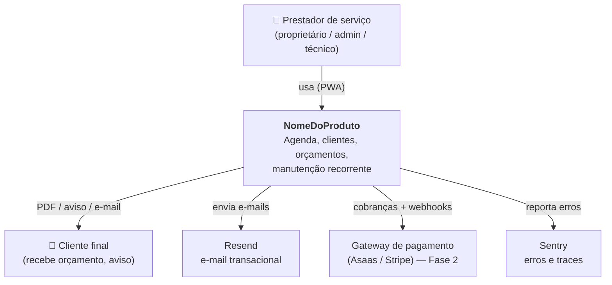
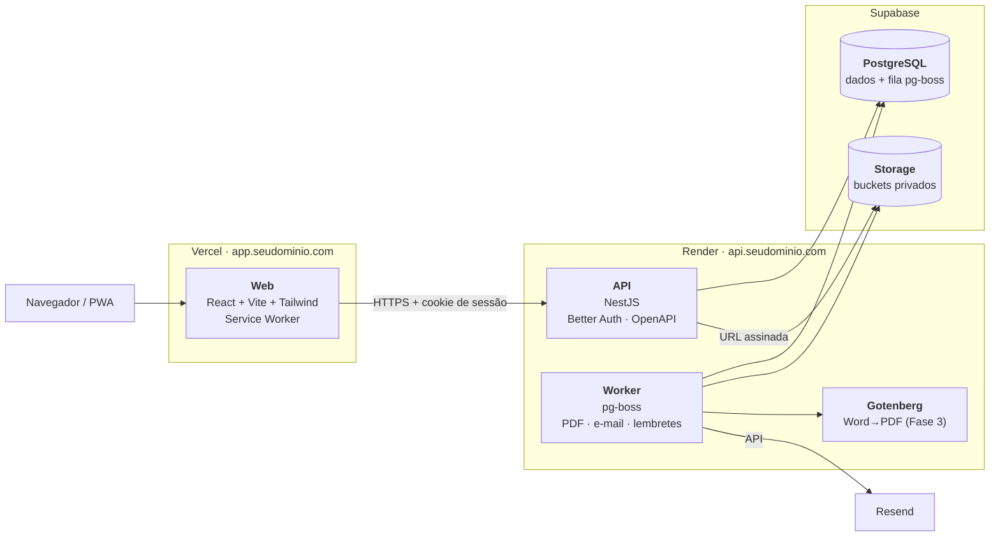

# 03 · Arquitetura

**Status:** Rascunho · Decisões ligadas: ADR-0002, 0003, 0004, 0005, 0006, 0008.

## Princípios

1. **Monólito modular.** Uma API NestJS com módulos por domínio. Sem microsserviços.
2. **Isolamento por organização é responsabilidade da plataforma**, não de cada query (ver ADR-0003).
3. **Trabalho pesado é assíncrono** (PDF, e-mail, lembretes) e roda em worker, fora do processo HTTP.
4. **Uma fonte de verdade para o contrato:** schemas Zod → OpenAPI → cliente tipado no front.
5. **Tudo que for de terceiro fica atrás de uma interface** (e-mail, storage, pagamento, geração de documentos).

## C4 · Nível 1 — Contexto



## C4 · Nível 2 — Contêineres



<!-- TODO: confirmar se API e worker serão dois serviços no Render ou o mesmo processo no MVP -->

## Estrutura do repositório (monorepo)

```
.agents/                  # contexto do projeto, rules e skills para trabalho assistido por IA
.github/workflows/        # esteira de CI (gitleaks, lint, typecheck, testes, build)
.githooks/                # hook nativo de pre-commit (bloqueio de .env/chaves + gitleaks)
apps/
  api/                    # NestJS
    src/
      modules/            # um módulo por domínio
        customers/  appointments/  maintenance/  quotes/  catalog/
        inventory/  finance/  invoices/  files/  notifications/
      platform/           # infraestrutura transversal
        auth/  tenancy/  database/  queue/  mail/  storage/  documents/
      main.ts
    prisma/               # schema.prisma + migrations
    test/
  web/                    # React
    src/
      features/           # espelha os módulos da API
      shared/             # ui, hooks, api-client gerado
      app/                # rotas, providers, PWA
packages/
  shared/                 # schemas Zod, enums, tipos comuns
docs/                     # documentação docs-as-code + ADRs
```

## Regras de dependência

- `modules/*` **não** importam uns dos outros diretamente; falam por **serviços exportados** do módulo ou por eventos de domínio.
- `platform/*` não conhece `modules/*`.
- Controllers só validam entrada, chamam um service e formatam saída. **Regra de negócio fica no service.**
- Acesso ao banco só passa pelo cliente Prisma **com escopo de organização** (ver ADR-0003).
- Nenhum módulo chama provedor externo diretamente: usa a interface de `platform/*`.

## Estrutura de um módulo

```
modules/quotes/
  quotes.module.ts
  quotes.controller.ts        # HTTP
  quotes.service.ts           # regras (RN-008, RN-013)
  quotes.repository.ts        # opcional; só se a query for complexa
  dto/                        # schemas Zod (nestjs-zod)
  quotes.service.spec.ts
```

## Processos assíncronos

| Job | Gatilho | Fila | Idempotência |
|---|---|---|---|
| `maintenance.scan` | Diário (cron do pg-boss) | `maintenance` | Chave `plan_id + ciclo` |
| `email.send` | Evento de domínio | `email` | `message_key` única |
| `quote.render-pdf` | Pedido do usuário | `documents` | `quote_id + revisão` |

## Decisões em aberto

- [ ] API e worker no mesmo processo no MVP? (simplifica; separar quando houver carga)
- [ ] Domínio final e subdomínios (ADR-0004)
- [ ] Estratégia de cache no PWA (ADR-0009)
