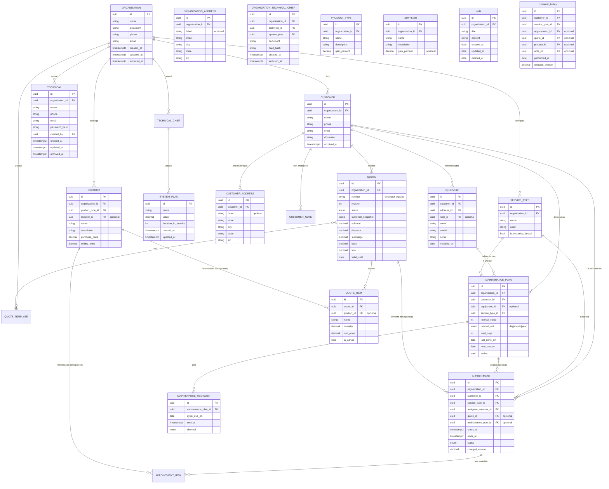

# 04 · Dados

**Status:** Rascunho — modelo conceitual do MVP. O schema Prisma é a fonte de verdade; este documento explica as decisões.

## Convenções

| Tema | Convenção | Motivo |
|---|---|---|
| Chave primária | `uuid` (v7 se possível) | Evita enumeração de IDs entre organizações |
| Tenant | Toda tabela de domínio tem `organization_id NOT NULL` + índice | RN-002 |
| Dinheiro | `Decimal(14,2)` | RN-011; o protótipo usava `Float` |
| Datas | `timestamptz` em UTC; fuso na organização | RN-012; o protótipo usava `String` |
| Enums | Enum do banco para estados fixos; tabela para tipos configuráveis | Tipos de atendimento variam por organização |
| Exclusão | `archived_at` (soft delete) onde houver histórico | RN-014 |
| Auditoria | `created_at`, `updated_at`, `created_by` | Rastreio |
| Nomes | Tabelas e colunas em inglês, `snake_case` (mapeadas no Prisma) | Padrão da comunidade |

> O Better Auth gerencia suas próprias tabelas (`user`, `session`, `account`, `organization`, `member`, `invitation`). Elas não aparecem no diagrama abaixo, exceto `organization`.

## Modelo conceitual (MVP)

## Multi-tenancy

Resumo (detalhes e alternativas em [ADR-0003](adr/0003-multi-tenancy.md)):

- Banco único, `organization_id` em toda tabela de domínio.
- Um **cliente Prisma com escopo** injeta o filtro da organização do usuário autenticado; o código de módulo não monta esse filtro manualmente.
- Defesa em profundidade: RLS no Postgres com `SET LOCAL app.organization_id` por transação. <!-- TODO: validar com o pooler do Supabase na PoC -->
- Teste obrigatório no CI: usuário da organização A não lê nem altera nada da organização B em **cada** endpoint.

## Mudanças em relação ao protótipo

| Protótipo | Novo | Por quê |
|---|---|---|
| `Float` para valores | `Decimal` | Arredondamento |
| `data`/`horaInicio` como texto | `starts_at`/`ends_at` `timestamptz` | Ordenação, recorrência, fuso |
| `tipo`/`status` texto livre | Enum + `service_type` configurável | Domínio genérico |
| Cliente com um `endereco` texto | `customer_address` (N) | Q: múltiplos endereços |
| Sem equipamentos | `equipment` | Q: equipamentos instalados |
| `observacoes` único | `customer_note` (N) | Q: anotações anexadas |
| Sem recorrência | `maintenance_plan` + `maintenance_reminder` | Diferencial |
| `Budget.numero @unique` global | Único por `organization_id` + ano | Multi-tenant |
| `clienteNome/Telefone/Endereco` no agendamento | Só `customer_id` | Evitar duplicação; snapshot fica só no orçamento |
| `Product.id` = ID do fornecedor | `product.id` próprio; `supplier_product` à parte (Fase 3) | Desacoplar |

## Dicionário de dados

<!-- TODO: gerar a partir do schema.prisma quando existir (ex.: prisma-markdown ou prisma-dbml-generator) e anexar aqui. Não escrever à mão. -->

## Retenção e dados pessoais

| Dado | Pessoal? | Retenção | Observação |
|---|---|---|---|
| Cliente (nome, telefone, e-mail, documento, endereço) | Sim | Enquanto a organização existir; apagar a pedido | Você é **operador**; a organização é a controladora <!-- TODO: validar com advogado --> |
| Anotações (podem conter senhas) | Potencialmente sensível | Idem | Considerar criptografia em nível de campo |
| Anexos | Possível | Idem | Bucket privado, URL assinada |
