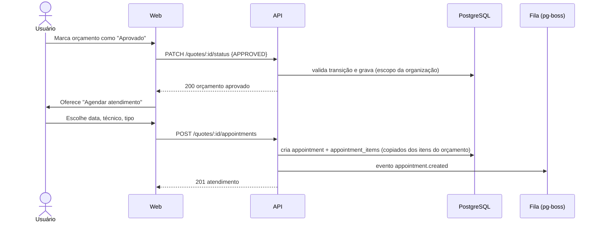
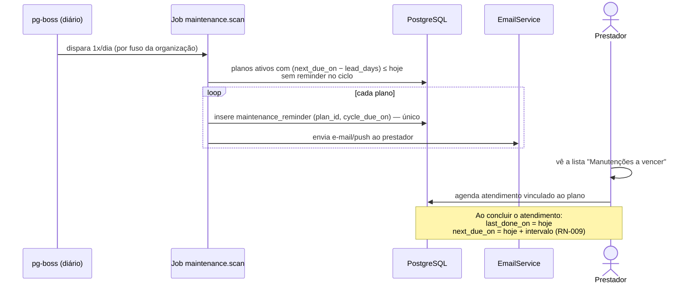
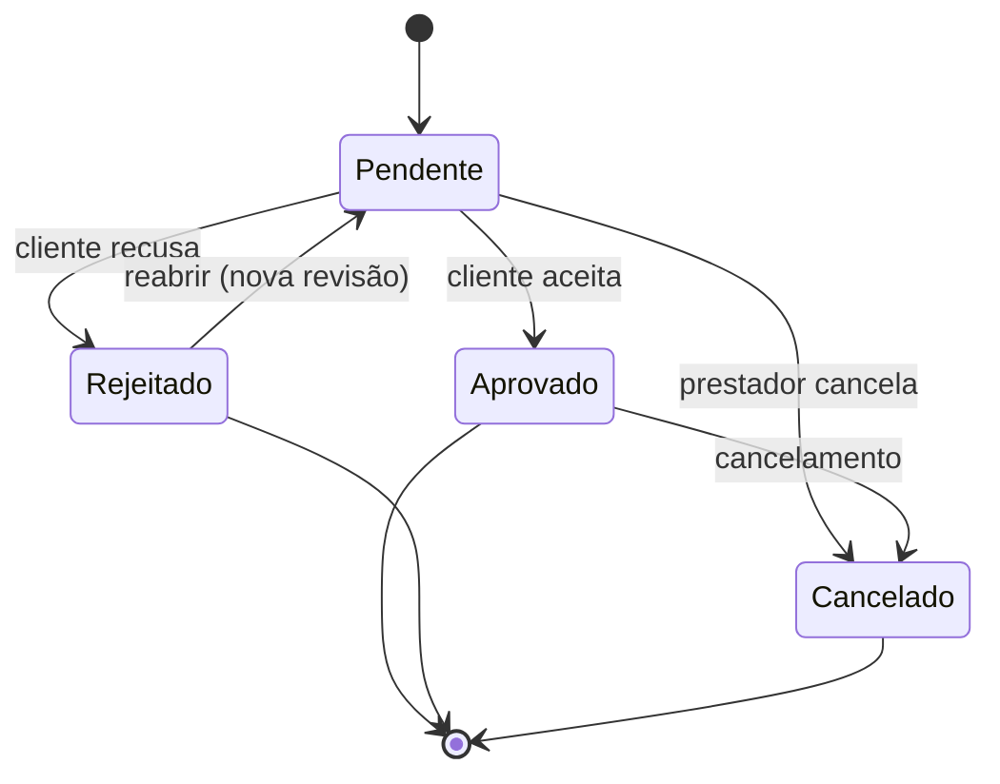
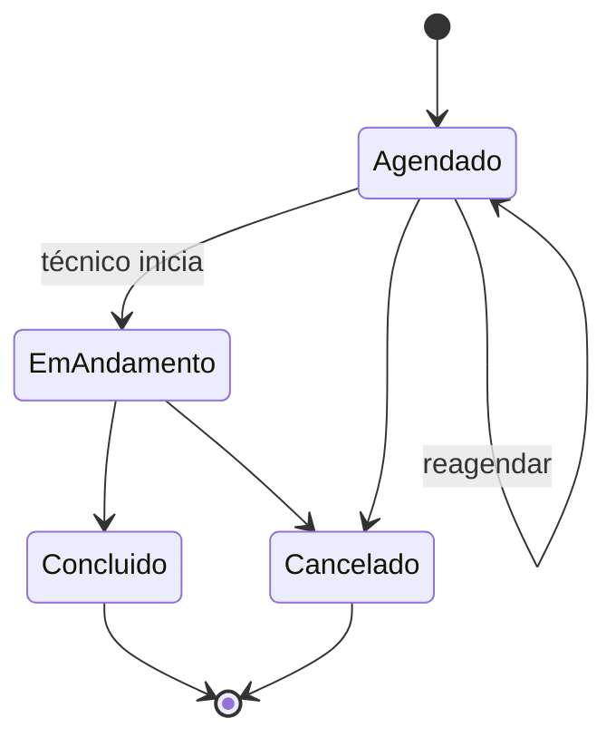
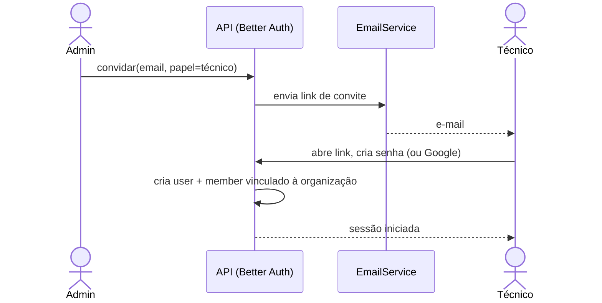
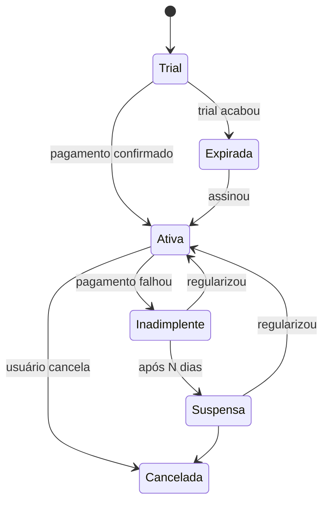

# 05 · Fluxos críticos

**Status:** Rascunho. Só documentamos o que é complexo ou arriscado. Detalhar cada fluxo **quando for implementado**.

| Fluxo | Tipo | Requisitos | Fase |
|---|---|---|---|
| Orçamento aprovado → agendamento | Sequência | RF-ORC-005, RN-007 | 1 |
| Ciclo do plano de manutenção e aviso | Sequência | RF-MAN-001…005, RN-009/010 | 1 |
| Estados do orçamento | Estado | RF-ORC-003 | 1 |
| Estados do atendimento | Estado | RF-AGE-001 | 1 |
| Convite de técnico | Sequência | RF-AUT-005 | 1 |
| Cobrança e webhook do gateway | Sequência | RF-FAT-003 | 2 |
| Estados da assinatura do SaaS | Estado | RF-PLT-003 | 2 |

## 1. Orçamento aprovado → agendamento

## 2. Plano de manutenção e aviso

## 3. Estados do orçamento

<!-- TODO: confirmar transições permitidas e se "Expirado" (validade vencida) vira estado -->

## 4. Estados do atendimento

<!-- TODO: conferir com os estados reais do protótipo (o default era AGENDADO) -->

## 5. Convite de técnico

## 6. Cobrança e webhook (Fase 2)

<!-- TODO: preencher quando escolher o gateway. Pontos obrigatórios: validação de assinatura do webhook, idempotência por event_id, reprocessamento, reconciliação diária. -->

## 7. Estados da assinatura do SaaS (Fase 2)

<!-- TODO: definir N dias, e o que "suspensa" permite (somente leitura?) -->
